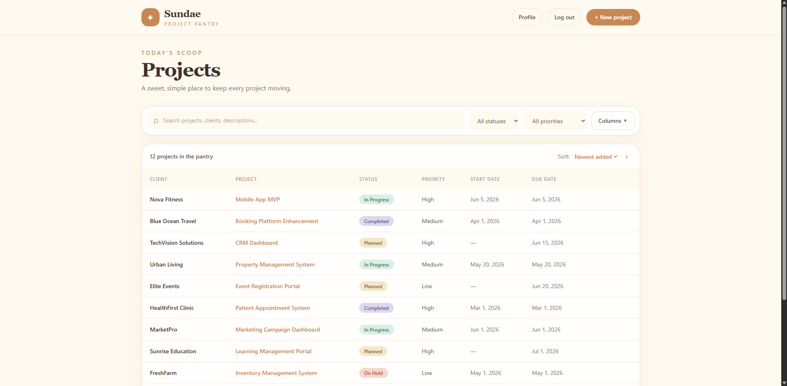
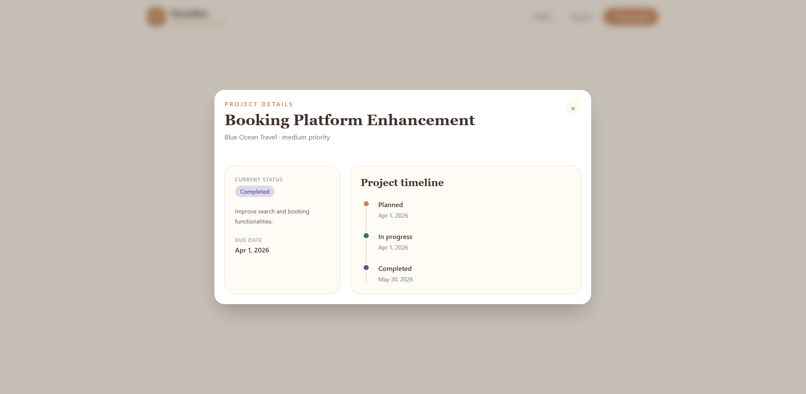

# Project Tracker

A full-stack application for tracking projects, built with a **Laravel REST API** and a **Vue** frontend. Users can create, view, update, and delete projects, and move them through a guided status flow with a timeline of their history.

> Submitted for the Full Stack Developer Technical Assessment.




---

## Table of Contents

1. [AI Tool Disclosure](#ai-tool-disclosure)
2. [Features](#features)
3. [Tech Stack](#tech-stack)
4. [Architecture](#architecture)
5. [Technical Decisions](#technical-decisions)
6. [Validation and Error Handling](#validation-and-error-handling)
7. [Getting Started](#getting-started)
8. [Default Credentials](#default-credentials)
9. [API Reference](#api-reference)
10. [Assumptions and Limitations](#assumptions-and-limitations)
11. [Development Log](#development-log)
12. [Demo Video](#demo-video)

---

## AI Tool Disclosure

AI tools were used in this project, as permitted by the assessment.

| Item            | Detail                                                                                          |
| --------------- | ----------------------------------------------------------------------------------------------- |
| Tool            | GitHub Copilot (agent mode)                                                                     |
| Model           | GPT-5.6 Luna                                                                                    |
| Used for        | Scaffolding the API, Vue application, implementation assistance, debugging, and iterative fixes |
| Human oversight | All generated code was reviewed, tested, and revised by the developer                           |

Every prompt used, each review finding, and the resulting fixes are documented in [LOGS.md](./LOGS.md).

The full development process is also visible in the [timelapse video](#demo-video).

---

## Features

### Backend — Laravel REST API

* User authentication
* Paginated project listing
* Create, view, update, and delete projects
* Search projects
* Filter projects by status
* Filter projects by priority
* Guided project status transitions
* Password confirmation for status-changing actions
* Password confirmation before project deletion
* Server-side validation
* Consistent JSON API responses

### Frontend — Vue

* Login page
* Profile page
* Logout with confirmation
* Change password
* Change name
* Projects table
* Project search
* Status filtering
* Priority filtering
* Column sorting
* Column visibility toggle
* Direct page-number input
* Clickable project rows
* Project details modal
* Project status timeline
* Reusable modal components
* Reusable toast notifications
* URL state synchronization
* Responsive interface
* Cream / ice-cream store themed design

---

## Tech Stack

| Layer           | Technology                         |
| --------------- | ---------------------------------- |
| Backend         | Laravel REST API                   |
| Frontend        | Vue                                |
| Styling         | Tailwind CSS                       |
| Database        | PostgreSQL                         |
| Language        | PHP                                |
| Package Manager | Composer / npm                     |
| Authentication  | Laravel application authentication |

---

## Architecture

```text
                    ┌─────────────────────┐
                    │      Vue SPA        │
                    │   Tailwind CSS      │
                    └──────────┬──────────┘
                               │
                               │ HTTP / JSON
                               ▼
                    ┌─────────────────────┐
                    │   Laravel REST API  │
                    │                     │
                    │ Controllers         │
                    │ Form Requests       │
                    │ API Resources       │
                    │ Validation          │
                    │ Authentication      │
                    └──────────┬──────────┘
                               │
                               │ Eloquent ORM
                               ▼
                    ┌─────────────────────┐
                    │     PostgreSQL      │
                    │                     │
                    │ Projects            │
                    │ Users               │
                    │ Related data        │
                    └─────────────────────┘
```

### Separation of Concerns

The Vue application communicates with the Laravel backend exclusively through the REST API.

* Vue handles presentation and client-side interaction.
* Laravel handles authentication, validation, business rules, and persistence.
* Form Requests handle request validation.
* API Resources provide consistent response structures.
* Controllers coordinate application behavior while keeping business logic organized.
* PostgreSQL provides persistent storage.

---

## Technical Decisions

| Decision                                             | Reason                                                                                       |
| ---------------------------------------------------- | -------------------------------------------------------------------------------------------- |
| Guided status flow instead of a free status dropdown | Preserves record integrity and prevents arbitrary status changes                             |
| New projects always start as `In Progress`           | Removes an unnecessary starting-state decision from the user                                 |
| Timeline derived from stored datetime values         | Avoids maintaining a separate history record that could become inconsistent with the project |
| Password confirmation on status actions              | Adds protection to state-changing operations                                                 |
| Password confirmation before deletion                | Helps prevent accidental destructive actions                                                 |
| Modal for project details                            | Keeps users in the context of the project list                                               |
| Timeline displayed below project details             | Allows users to understand the project's progression without leaving the current view        |
| URL synchronized with UI state                       | Supports browser refresh, back/forward navigation, and shareable project views               |
| Confirmation before logout                           | Prevents accidental session termination                                                      |
| Reusable modal and toast components                  | Reduces duplication and keeps frontend behavior consistent                                   |

### Status Flow

Projects follow a guided status flow rather than allowing arbitrary status selection.

| Current Status | Allowed Actions   | Password Required |
| -------------- | ----------------- | ----------------- |
| Planned        | In Progress, Hold | Yes               |
| In Progress    | Complete, Hold    | Yes               |
| On Hold        | Un-hold           | Yes               |
| Complete       | None              | N/A               |

### Status Flow Diagram

```text
                 ┌─────────────┐
                 │   Planned   │
                 └──────┬──────┘
                        │
                        ▼
                 ┌─────────────┐
                 │ In Progress │
                 └───┬─────┬───┘
                     │     │
              ┌──────┘     └──────┐
              ▼                   ▼
        ┌──────────┐        ┌───────────┐
        │ On Hold  │        │ Complete  │
        └────┬─────┘        └───────────┘
             │
             │ Un-hold
             ▼
        ┌─────────────┐
        │ In Progress │
        └─────────────┘
```

---

## Validation and Error Handling

The API validates incoming project data before processing requests.

| Field        | Validation                            |
| ------------ | ------------------------------------- |
| Client Name  | Required                              |
| Project Name | Required                              |
| Status       | Must be a valid project status        |
| Priority     | Must be a valid project priority      |
| Due Date     | Cannot be earlier than the Start Date |

### Error Handling

Invalid requests return meaningful validation errors that can be displayed at the field level in the frontend.

The Vue application surfaces errors through:

* Inline form validation messages
* Toast notifications
* API error responses

Validation is enforced by the Laravel API rather than relying solely on frontend validation. This ensures that API consumers cannot bypass the application's business rules by sending requests directly to the backend.

---

## Getting Started

### Prerequisites

Make sure the following are installed:

* PHP 8.2 or higher
* Composer
* Node.js
* npm
* PostgreSQL

### Backend Setup

Clone the repository and install the PHP dependencies:

```bash
composer install
```

Create the environment file:

```bash
cp .env.example .env
```

Generate the Laravel application key:

```bash
php artisan key:generate
```

Configure the PostgreSQL connection in `.env`:

```env
DB_CONNECTION=pgsql
DB_HOST=127.0.0.1
DB_PORT=5432
DB_DATABASE=client-project-tracker
DB_USERNAME=postgres
DB_PASSWORD=your_password
```

Run the database migrations and seed the development data:

```bash
php artisan migrate --seed
```

Start the Laravel development server:

```bash
php artisan serve
```

The backend will be available at:

```text
http://localhost:8000
```

### Frontend Setup

Install the frontend dependencies:

```bash
npm install
```

Configure the frontend API base URL using the environment variable expected by the Vue application.

Then start the development server:

```bash
npm run dev
```

---

## Default Credentials

The development database is seeded with a default user account.

| Field    | Value                           |
| -------- | ------------------------------- |
| Email    | `marcoangelo.quanico@gmail.com` |
| Password | `quanico`                       |

> These credentials are intended for development and technical-assessment evaluation only.

The database seeder also creates sample project records for demonstration purposes.

---

## API Reference

### Authentication

| Method | Endpoint     | Description         |
| ------ | ------------ | ------------------- |
| POST   | `/api/login` | Authenticate a user |

### Projects

| Method | Endpoint             | Description      |
| ------ | -------------------- | ---------------- |
| GET    | `/api/projects`      | List projects    |
| POST   | `/api/projects`      | Create a project |
| GET    | `/api/projects/{id}` | View a project   |
| PUT    | `/api/projects/{id}` | Update a project |
| DELETE | `/api/projects/{id}` | Delete a project |

### Project Listing

The project listing endpoint supports:

| Parameter  | Description                                     |
| ---------- | ----------------------------------------------- |
| `search`   | Search projects by relevant project information |
| `status`   | Filter projects by status                       |
| `priority` | Filter projects by priority                     |
| `page`     | Select the pagination page                      |

Example:

```text
GET /api/projects?search=website&status=in_progress&priority=high&page=1
```

> All API routes should be accessed through the Laravel application's configured base URL.

---

## Project Lifecycle

New projects are created with the initial status:

```text
In Progress
```

From there, the project can move through the supported workflow:

```text
In Progress
     │
     ├──────────────► On Hold
     │                   │
     │                   │ Un-hold
     │                   ▼
     │              In Progress
     │
     └──────────────► Complete
```

A completed project is considered terminal and cannot be moved to another status.

---

## Assumptions and Limitations

The following assumptions were made for the assessment:

* The application is designed around single-user-style access.
* Role-based access control is not implemented.
* `Complete` is a terminal status.
* Project history is represented using the project's stored date/time values rather than a dedicated audit-log table.
* The application is intended primarily as a demonstration of the requested full-stack functionality rather than a production-ready multi-tenant system.

### Potential Improvements

With additional development time, the following could be added:

* Expanded automated test coverage for API and frontend workflows
* Role-based access control
* Dedicated audit-log/history table
* More comprehensive API documentation
* Automated API documentation using OpenAPI/Swagger
* Additional accessibility testing
* Cross-browser testing
* More granular project permissions
* More detailed project activity tracking
* Production deployment configuration
* CI/CD pipeline

---

## Development Log

The step-by-step development history is documented in [`LOGS.md`](./LOGS.md).

The development log contains:

* Copilot prompts
* Review findings
* Implementation decisions
* Identified issues
* Resulting fixes
* Iterative development notes

This provides a transparent record of how AI-assisted development was used throughout the assessment.

---

## Demo Video

A timelapse recording of the full build process is available here:

**[Watch the timelapse on Google Drive](https://drive.google.com/drive/folders/14I1RJS8iefi1ltof1Mgs5I5G7CHKsHhN?usp=sharing)**

The recording demonstrates the development process from implementation through iterative fixes.

> [!IMPORTANT]
> **Build Session Time**
>
> | | |
> | --- | --- |
> | **Started** | **October 3, 2026 – 4:15 PM** |
> | **Ended** | **October 3, 2026 – 5:55 PM** |
> | **Total duration** | **1 hour 40 minutes** |

---

## Submission Notes

This project was developed as part of a Full Stack Developer Technical Assessment.

The implementation demonstrates:

* REST API development with Laravel
* PostgreSQL database integration
* Vue SPA development
* Tailwind CSS UI implementation
* Authentication
* Server-side validation
* CRUD operations
* Guided business workflows
* API/frontend separation
* Error handling
* Responsive UI design
* AI-assisted development with documented human review
